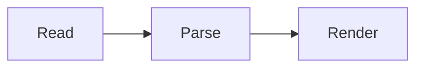
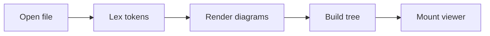
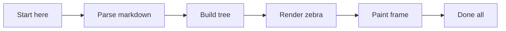
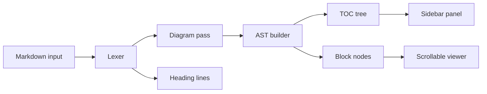
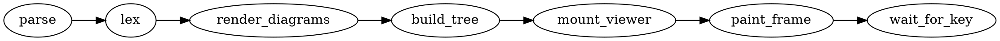
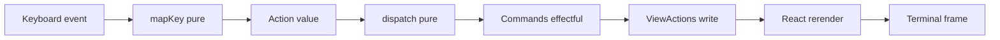
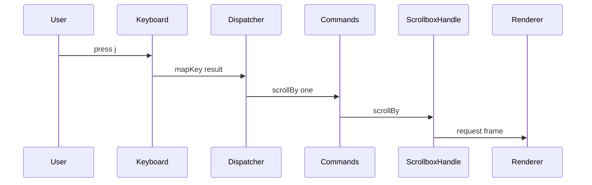
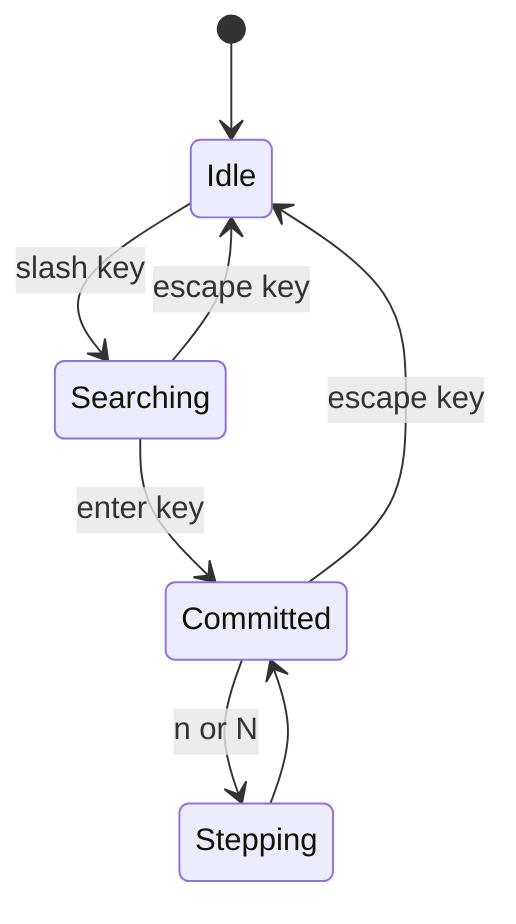

# Mermaid Width Fitting

Manual check for diagram width fitting. A rendered diagram wider than its
column re-renders with tighter spacing (smaller gaps between nodes, then no
blank rows inside boxes) until it fits. If no spacing fits, the tightest
render shows and the right side clips.

Widths below are in columns; a diagram needs its width + 4 for the side
margins. With the TOC shown, diagrams stop at the content cap (default 100).
With the TOC hidden (`t`), prose grows only by the sidebar width, but diagrams
break out across the whole terminal, and the scrollbar moves to its right edge.

| Diagram        | Default | Tightest | Expected at the 100 cap       |
| -------------- | ------- | -------- | ----------------------------- |
| Small chain    | 37      | 23       | default spacing               |
| Medium chain   | 96      | 70       | default spacing (exact fit)   |
| Wide chain     | 114     | 82       | compact, whole                |
| Branching flow | 120     | 88       | compact, whole                |
| DOT chain      | 126     | 88       | compact, whole                |
| Huge chain     | 180     | 136      | tightest, right side clipped  |
| Sequence       | 97      | 97       | no compaction, clips 1 column |
| State machine  | 27      | 27       | default spacing               |

Things to check:

1. At a wide terminal with the TOC shown, every row in the table above
   matches its "Expected" column.
2. Narrow the terminal (or drag the TOC seam left): diagrams step down to
   tighter spacing one by one, and the Medium chain starts to compact.
3. Hide the TOC with `t` at a terminal of 186+ columns: every diagram,
   including the Huge chain, shows whole at default spacing, while prose still
   wraps near column 100 plus the sidebar width.
4. Scroll a diagram up under the sticky header: no part of it shows to the
   right of the header.
5. Search `/zebra` and press Enter: the match highlights inside the Wide
   chain, and the search bar sits at the right edge. Resize or toggle the TOC;
   the highlight stays on the label.
6. Diagrams nested in a list and a blockquote fit the same way.

## Small chain



## Medium chain



## Wide chain

The `zebra` label is the search target.



## Branching flow



## DOT chain



## Huge chain

Too wide for any spacing at the default cap: with the TOC shown, the tightest
render shows and the right side clips. Hide the TOC on a wide terminal to see
it whole.



## Sequence

The ASCII renderer has no spacing knobs for sequence, class, or ER diagrams,
so these keep their width at every step.



## State machine

A top-down layout: narrow already, so it never compacts.



## Nested

- A list item holding the Wide chain:

  ```mermaid
  graph LR
    A[Start here] --> B[Parse markdown] --> C[Build tree] --> D[Render React] --> E[Paint frame] --> F[Done all]
  ```

> A blockquote holding the Branching flow:
>
> ```mermaid
> flowchart LR
>   In[Markdown input] --> Lex[Lexer]
>   Lex --> Pre[Diagram pass]
>   Lex --> Lines[Heading lines]
>   Pre --> Tree[AST builder]
>   Tree --> Toc[TOC tree]
>   Tree --> Nodes[Block nodes]
>   Nodes --> Viewer[Scrollable viewer]
>   Toc --> Sidebar[Sidebar panel]
> ```
